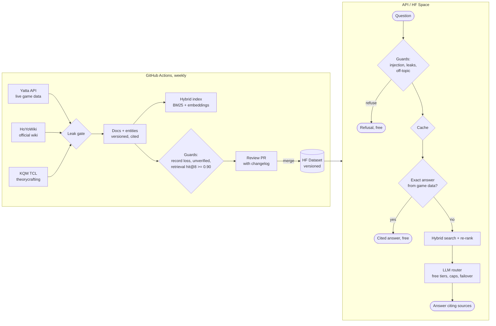

# Irminsul v1

**A Genshin Impact assistant that answers from official, version-tagged game data, cites every
answer, and refuses leaks.** Built to be useful to players and cheap enough to run for free.

> Status: v1 in development on the `v1` branch. The original v0 (QLoRA fine-tune + Pinecone
> RAG) is preserved at the [`v0` release](https://github.com/MukulRay1603/Irminsul/releases/tag/v0).

## What makes it different
- **Official first.** Game text comes from the live client data (Yatta API) and HoYoverse's own
  wiki (HoYoWiki). Theorycrafting comes from the KQM library. Every chunk carries its source URL,
  trust tier, game version and release status.
- **No leaks, by construction.** A leak gate drops anything not proven released. Officially
  announced characters get an overview only. Questions about leaks, datamines, betas or
  unannounced versions are refused before any model is called.
- **The LLM is the last resort.** Exact questions (stats, constellations, passives, set bonuses)
  are answered straight from structured game data in ~0.1 ms. Only the rest goes to
  retrieval + an LLM, which must cite numbered sources.
- **Measured.** A 107-item golden eval set scores retrieval and answers on every change.
- **Explainable.** Every answer returns a trace: route, retrieved docs and scores, provider,
  tokens and latency.

## Results (Oct 26 2026)
| | v0-style | v1 |
|---|---|---|
| Retrieval hit@3 (96 golden questions) | 0.490 | **0.875** |
| Retrieval MRR@3 | 0.405 | **0.812** |
| Retrieval hit@8 | 0.677 | **0.979** |
| Golden items answered correctly **without an LLM** | – | **91 / 91 scored** (77 exact, 3 announced, 11 refusals) |
| Share of the golden set needing no LLM call | – | **85%** |
| Retrieval latency (CPU, re-ranked) | – | ~300 ms p50 |

"v0-style" = v0's retrieval configuration (all-MiniLM-L6-v2, dense only) over the same v1 corpus,
so the comparison isolates retrieval. Details: [`reports/`](reports/).

## Architecture

More in [`docs/architecture.md`](docs/architecture.md).

## Quickstart
```bash
uv sync                                                  # Python 3.12 + deps (no torch)
uv run pytest                                            # offline tests, no network or models

uv run irminsul-build --out data/build --cache data/cache                # build the corpus
uv run irminsul-index build --docs data/build/docs.jsonl --out data/index
uv run irminsul-index eval --index data/index                            # retrieval metrics
uv run irminsul-answer-eval --build data/build                           # answer metrics (no LLM)

IRMINSUL_DATA=data/build IRMINSUL_INDEX=data/index uv run irminsul-serve   # API on :7860
curl -X POST localhost:7860/ask -H 'content-type: application/json' \
     -d '{"question": "What is Raiden Shogun'"'"'s base ATK at 90?"}'
```
LLM providers (Groq, Cerebras, Gemini, OpenRouter) are enabled by setting their API keys as
environment variables. Without keys, exact answers and refusals still work.

On a Hugging Face Space, set `IRMINSUL_TRUSTED_PROXY_HOPS=1` so the per-player limits and Resin
key on the real client address behind the Space proxy (the default, 0, ignores
`X-Forwarded-For`). Other security settings and the threat model are in
[`docs/security.md`](docs/security.md); to report a problem, see [`SECURITY.md`](SECURITY.md).

## Repository map
| Path | What |
|---|---|
| `src/irminsul/sources/` | Yatta, HoYoWiki, KQM and team-notes sources, plus a polite HTTP client |
| `src/irminsul/pipeline/` | build, leak gate, render, diff/guards, publish |
| `src/irminsul/retrieval/` | chunking, hybrid index, retrieval eval |
| `src/irminsul/engine/` | guards, entity store, exact answers, LLM router, engine, answer eval |
| `src/irminsul/api/` | FastAPI app, rate limits and LLM budget, server |
| `evals/` | golden eval set (107 items) |
| `reports/` | measured results |
| `.github/workflows/` | CI, weekly corpus update, publish |

## Sources and licences
- **Genshin Impact** content and materials are trademarks and copyrights of HoYoverse. This is an
  unofficial fan project, not affiliated with or endorsed by HoYoverse.
- **KQM docs** are derived from the [KQM Theorycrafting Library](https://github.com/KQM-git/TCL)
  by the KQM community, licensed
  [CC BY-NC-SA 4.0](https://creativecommons.org/licenses/by-nc-sa/4.0/). Each doc links to the
  source file at the exact TCL commit it was built from. Derived KQM text keeps the same licence
  and must not be used commercially.
- **Game data** via the [Yatta API](https://gi.yatta.moe) and HoYoverse's
  [HoYoWiki](https://wiki.hoyolab.com).

Code: MIT, see [LICENSE](LICENSE).
