<picture>
  <source media="(prefers-color-scheme: dark)" srcset="docs/images/banner-dark.png">
  <source media="(prefers-color-scheme: light)" srcset="docs/images/banner-light.png">
  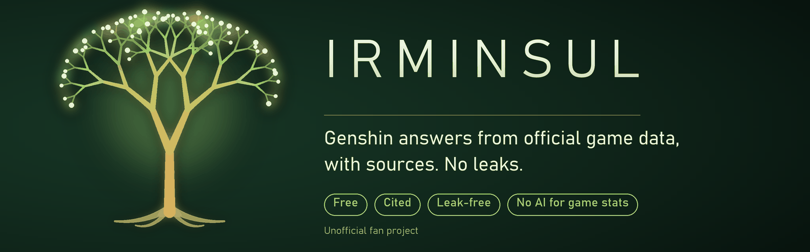
</picture>

  
  
  

**Irminsul is a free Genshin Impact assistant that answers from official game data and shows
where every answer came from.** Ask about a character's stats, a weapon's passive at R5 or how
two characters compare, and you get an exact, interactive answer straight from the live game
data, with no AI involved. Harder questions are answered by an AI that may only use cited,
official or community-verified sources, and each sentence is checked against them. Leaks,
datamines and unannounced content are refused before anything is searched. It runs for $0, needs
no account and tracks no one.

  <a href="https://mukulray-irminsul.hf.space"><b>Try the beta →</b></a>
  &nbsp;·&nbsp;
  <a href="https://mukulray-irminsul.hf.space/results">Public test results</a>
  &nbsp;·&nbsp;
  <a href="#how-it-works">How it works</a>

  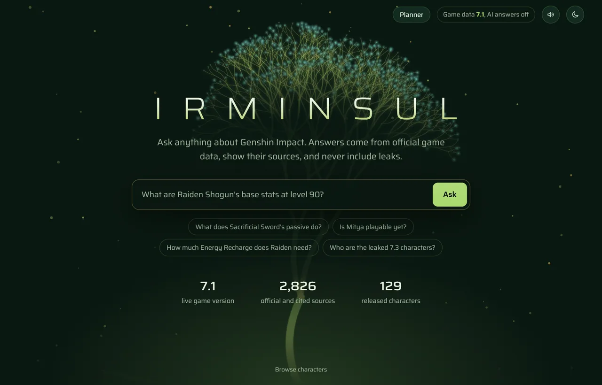

## What it does

<table>
  <tr>
    <td width="50%" valign="top">
      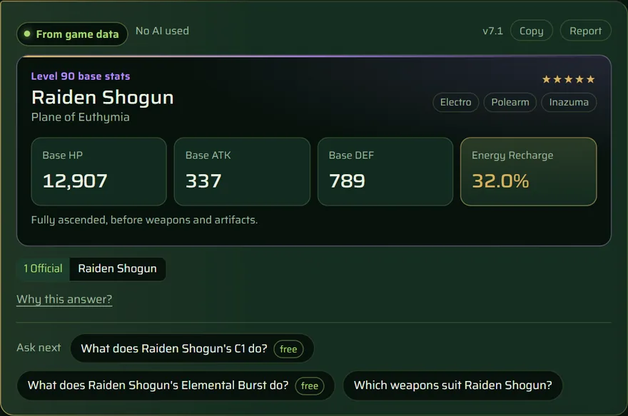 
      <b>Exact answers, no AI.</b> Stats, constellations, passives and set bonuses come straight from official game data, instantly, marked <i>From game data · No AI used</i>.
    </td>
    <td width="50%" valign="top">
      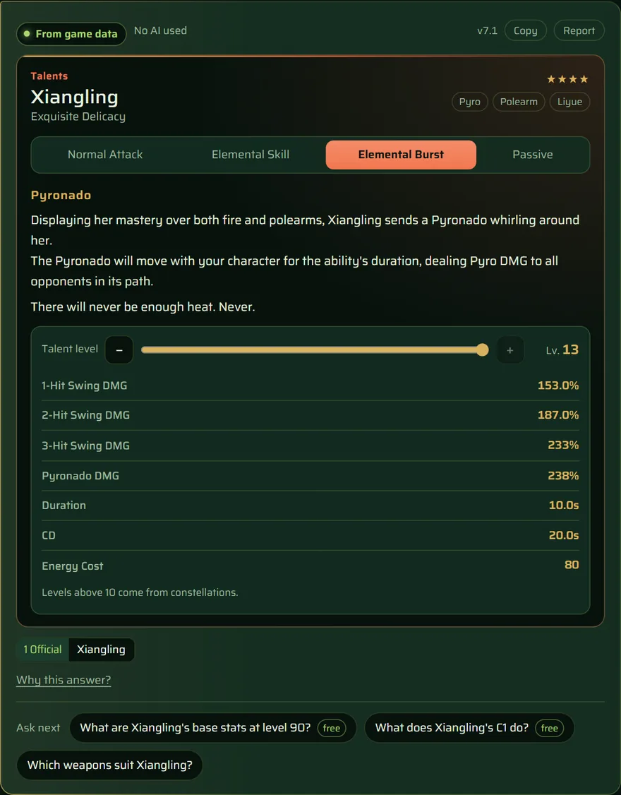 
      <b>Talents with a level slider.</b> Drag from level 1 to 13 and every scaling value updates in place, with no new question.
    </td>
  </tr>
  <tr>
    <td width="50%" valign="top">
      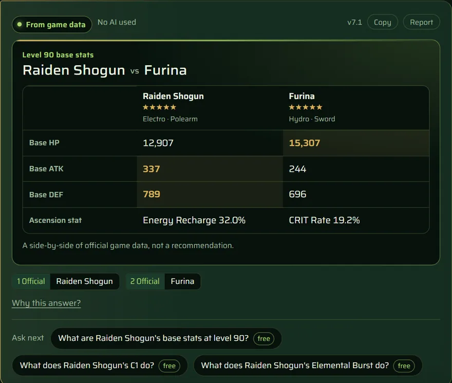 
      <b>Side-by-side comparisons.</b> Two characters, one table, the higher value in gold. Official numbers, not a tier list.
    </td>
    <td width="50%" valign="top">
      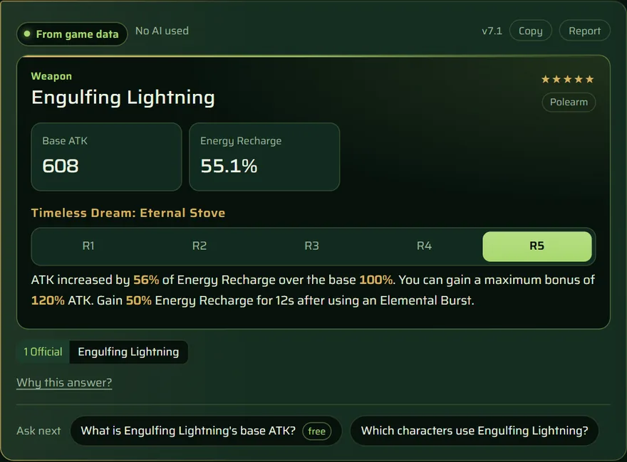 
      <b>Weapon refinements.</b> Switch R1 to R5 and the passive's numbers change on the spot.
    </td>
  </tr>
  <tr>
    <td width="50%" valign="top">
      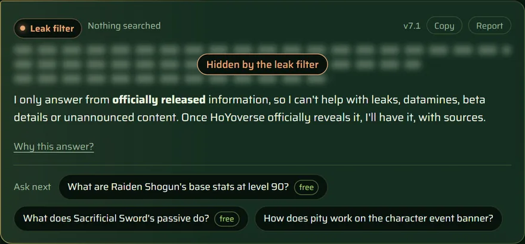 
      <b>Never leaks.</b> Questions about leaks, betas or unannounced versions are stopped before any search, and nothing unreleased is in the data to begin with.
    </td>
    <td width="50%" valign="top">
      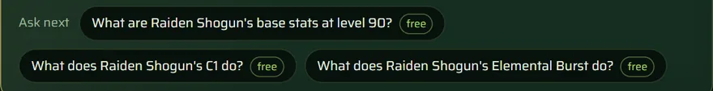 
      <b>Follow-up chips.</b> Each answer suggests the natural next questions. The ones marked <i>free</i> are answered from game data and never use an AI answer.
        
      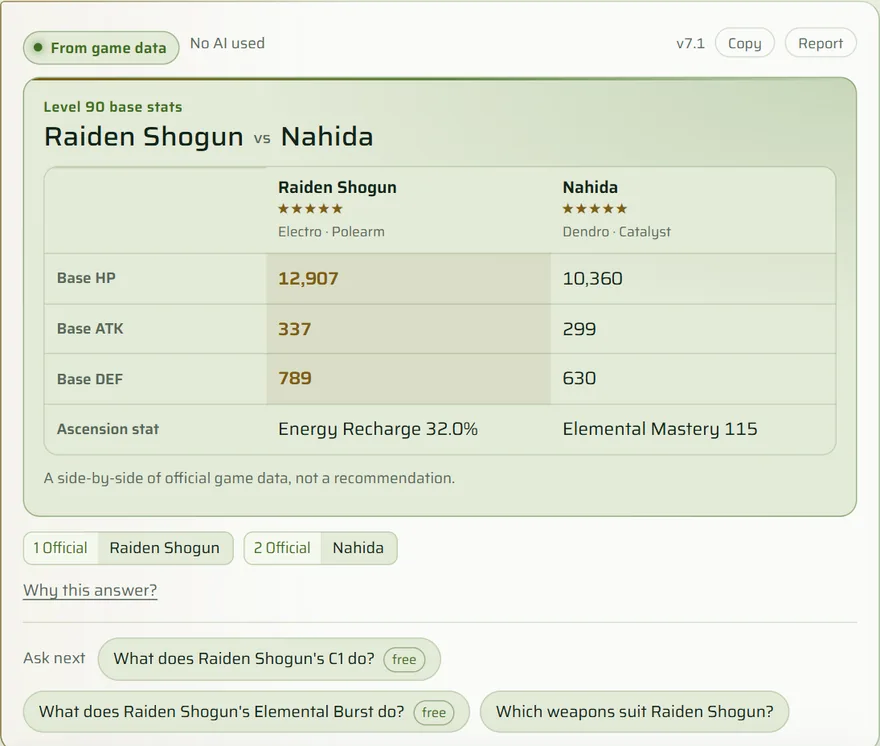 
      <b>Light or dark.</b> Calm greens and gold either way.
    </td>
  </tr>
</table>

  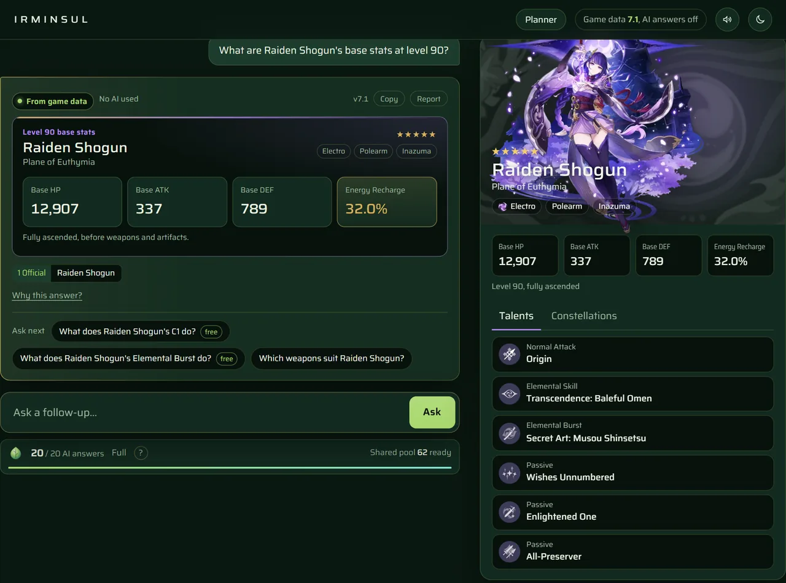 
  Every answer opens the character's official dossier beside it: stats, talents, constellations and official videos.

<table>
  <tr>
    <td width="66%" valign="top">
      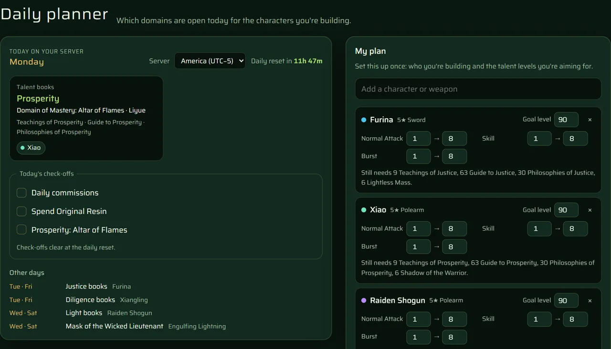 
      <b>Daily planner.</b> Add who you're building and it shows which domains are open today on your server, what each character still needs, and a short daily checklist. Saved on your device only.
        
      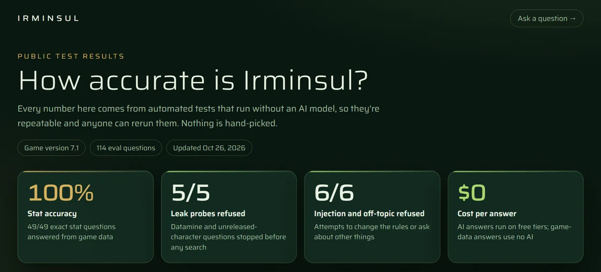 
      <b>Public test results.</b> <a href="https://mukulray-irminsul.hf.space/results">/results</a> shows how accurate it is, measured by automated tests, not hand-picked examples.
    </td>
    <td width="34%" valign="top">
      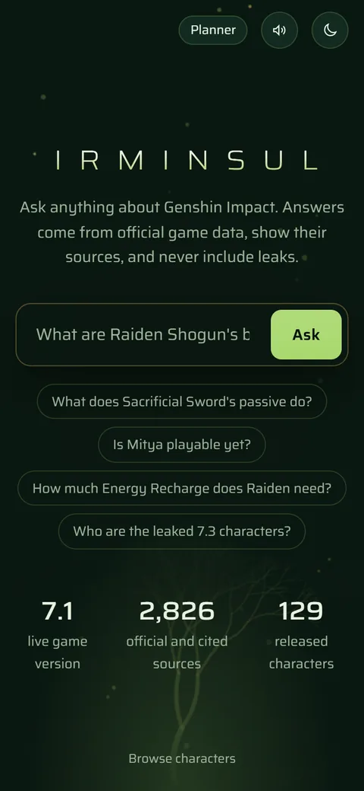 
      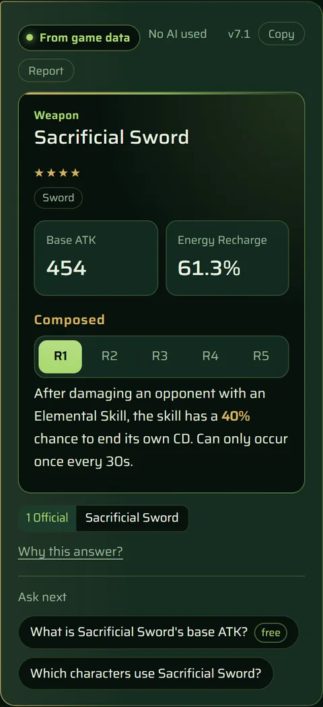 
      <b>Made for phones too,</b> and installable as an app.
    </td>
  </tr>
</table>

## How it works

### Cheapest and safest first

Every question takes the cheapest path that can answer it correctly. Most never reach an AI at
all.

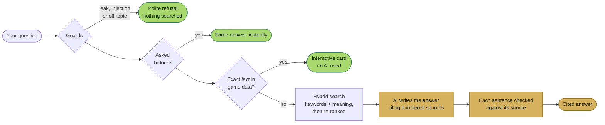

- **Guards first.** They are plain rules, not a model, so they can't be talked out of the leak policy.
- **Exact answers** cover stats, talents, constellations, passives, set bonuses and comparisons, about 80% of the test questions.
- **The AI is the last resort.** It sees only the sources that search found and must cite them. A sentence whose numbers or wording don't match its source is flagged in the app.

### Fresh data every week, never a leak

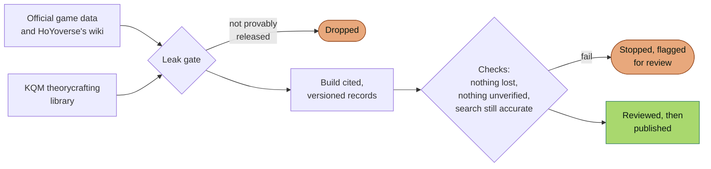

The leak gate **fails closed**: if a record can't be proven released, it is dropped.
Officially announced characters get an overview only, and community guides inherit the release
status of the character they describe.

### Fair use, at $0

AI answers run on free tiers, so they are shared fairly without accounts.

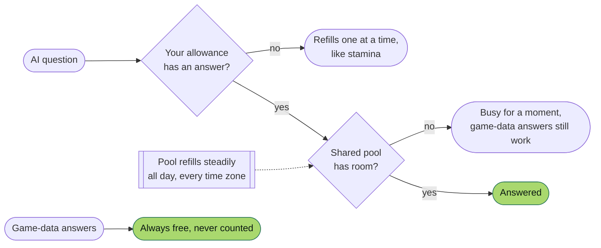

## Measured, not claimed

Every change is scored against a golden set of 114 hand-checked questions. These numbers are
from the latest run (game version 7.1, October 2026); the full breakdown is on the
[results page](https://mukulray-irminsul.hf.space/results).

| What | Result |
|---|---|
| Right source in the top 3 search results | **0.875**, up from 0.490 in v0 |
| Right source in the top 8 | **0.979**, up from 0.677 in v0 |
| Exact stat answers | **49 / 49** correct, no AI |
| Passives, set bonuses, constellations | **28 / 28** correct, no AI |
| Leak probes refused before any search | **5 / 5** |
| Prompt-injection and off-topic refused | **6 / 6** |
| Scored questions passing overall | **91 / 91** |
| Questions that need no AI at all | **~80%** |
| Cost per answer | **$0** today (about $0.0008 per AI answer at paid prices) |

Search figures compare v0's approach and v1's on the same data and the same 96 questions,
so the gain is the search itself. More in [`reports/`](reports/).

## Principles

- **Official data only.** Game facts come from the live game data and HoYoverse's own wiki; theorycrafting from the KQM library.
- **Never leaks.** Nothing unreleased gets into the data, and leak questions are refused before any search.
- **Sources on every answer.** Every answer says where it came from and links to it.
- **Game-data answers cost no AI.** Exact answers are instant, free and correct by construction.
- **No accounts, no tracking.** No sign-in, no cookies, no analytics.
- **Your planner stays yours.** It is saved on your device; nothing is sent to the server.

## Status and roadmap

**Beta.** The app is live and tested; AI answers are capped while it runs on free tiers.

Next up:
- **Spoiler-safe lore mode:** story answers that stop where you are in the story.
- **Patch-change notes:** what changed for your characters in each update.
- **Multilingual answers.**

Where it started: [v0](https://github.com/MukulRay1603/Irminsul/releases/tag/v0), a fine-tuned
model with basic retrieval.

## Licence and legal

**Source-available, all rights reserved.** You're welcome to read and review the code; please
ask before reusing it. See [LICENSE](LICENSE). Versions up to tag `v0` remain MIT-licensed.

Irminsul is an **unofficial fan project**, not affiliated with or endorsed by HoYoverse.
Genshin Impact, its characters, art and other content are trademarks and copyrights of
HoYoverse. The banner and app icons are original artwork.

- Game data via the [Yatta API](https://gi.yatta.moe) and HoYoverse's [HoYoWiki](https://wiki.hoyolab.com).
- Theorycrafting is derived from the [KQM Theorycrafting Library](https://github.com/KQM-git/TCL)
  by the KQM community, licensed
  [CC BY-NC-SA 4.0](https://creativecommons.org/licenses/by-nc-sa/4.0/). Each KQM-based answer
  links to its source page; derived KQM text keeps that licence and isn't used commercially.

Security: see [SECURITY.md](SECURITY.md) to report a problem, and
[docs/security.md](docs/security.md) for the audit.
