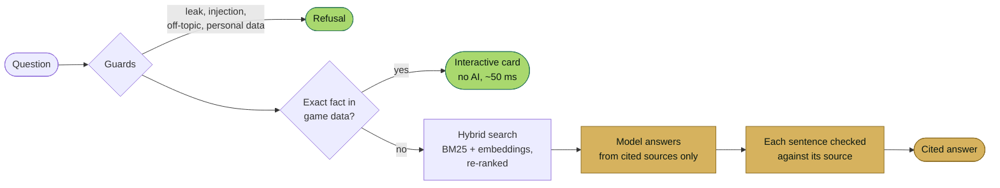

<picture>
  <source media="(prefers-color-scheme: dark)" srcset="docs/images/banner-dark.png">
  <source media="(prefers-color-scheme: light)" srcset="docs/images/banner-light.png">
  
</picture>

  <a href="https://mukulray-irminsul.hf.space"><b>Live demo</b></a>
  &nbsp;·&nbsp;
  <a href="https://mukulray-irminsul.hf.space/results">Test results</a>
  &nbsp;·&nbsp;
  <a href="#how-it-works">How it works</a>

**Irminsul is a free AI assistant for Genshin Impact that cites a source for every answer and never leaks.**
Stats, talents, constellations and weapon passives come straight from the live game data, with
no AI involved. Questions that need explaining, such as builds, teams, mechanics, events and lore, are
answered by a model that may only use cited sources, and each sentence is checked against them.
Unreleased content is kept out of the data entirely. Irminsul answers in the player's own language,
can keep lore free of story spoilers, needs no account, and runs at no cost.

  

## Highlights

- **Answers you can check.** Every answer links its sources. Answers from game data are marked *No AI used*.
- **Leak-free by construction.** A release gate drops anything that can't be proven released before it is indexed. Leak and datamine questions are refused before any search.
- **Builds for every released character.** 129 characters' weapons, artifacts, stats and teams, each line credited to its guide (KQM, Game8, Icy Veins) and checked against that guide's page.
- **Live game news.** Banners, events and redemption codes from HoYoverse's official notices, with expired codes and events called out as expired.
- **Spoiler-safe lore.** Story answers stop at the player's Archon Quest progress.
- **Any language.** Questions in Chinese, Japanese, Korean, Spanish, Portuguese and more are answered in that language, with the same sources and guards.
- **More than chat:**
  - interactive stat, talent and comparison cards
  - patch notes by version
  - a daily farming planner saved only on the player's device

## How it works

Every question takes the cheapest path that answers it correctly. Most never reach a model.

- **The data refreshes itself.** A daily job rebuilds the corpus from official sources and runs three gates: leaks, search quality, and safety. Routine changes publish and redeploy automatically, and riskier changes wait for a person to review them.
- **Guards are rules, not a model,** so they can't be argued out of the leak policy. A second check filters the model's output.
- **Fair use without accounts.** Each player gets a refilling allowance of AI answers. Answers from game data are always free.

## Measured, not claimed

| | |
|---|---|
| Live site, full test set with the real model | **113 / 118** scored (95.8%), with all 19 leak, injection, privacy, safety and off-topic probes handled correctly |
| Offline test set (guards, exact answers, refusals) | **101 / 101** |
| Story leaks past the player's progress, in spoiler-safe mode | **0** |
| Right source in the top 8 search results | **0.946** on 93 questions |
| 50 concurrent users | **210 req/s**, p95 **0.45 s**, zero errors |
| Mobile layout shift (CLS) | **0.04** (down from 0.92) |
| Build recommendations checked against their sources | **1,022 lines**, none unsupported |
| Running cost | **$0** (free model tiers) |

The full breakdown, updated on every change, is on the [results page](https://mukulray-irminsul.hf.space/results).

## Built with

Python · FastAPI · hybrid retrieval (BM25, `bge-small-en-v1.5`, cross-encoder re-ranking on ONNX) ·
free LLM tiers with failover · Hugging Face Spaces and Datasets · GitHub Actions ·
a vanilla-JS front end under a strict Content Security Policy

## Status

Live beta for Genshin Impact 7.1. It started as [v0](https://github.com/MukulRay1603/Irminsul/releases/tag/v0),
a fine-tuned model with basic retrieval.

## Licence and credits

**Source-available, all rights reserved.** You're welcome to read and review the code. Please ask
before reusing it. See [LICENSE](LICENSE). Versions up to tag `v0` remain MIT-licensed.

Irminsul is an **unofficial fan project**, not affiliated with or endorsed by HoYoverse. Genshin
Impact and its characters, art and other content are trademarks and copyrights of HoYoverse.

- Game data via the [Yatta API](https://gi.yatta.moe) and HoYoverse's [HoYoWiki](https://wiki.hoyolab.com) and news.
- Theorycrafting from the [KQM Theorycrafting Library](https://github.com/KQM-git/TCL)
  ([CC BY-NC-SA 4.0](https://creativecommons.org/licenses/by-nc-sa/4.0/)). Build recommendations credit
  KQM, Game8 or Icy Veins and link the page each came from.

Security issues: see [SECURITY.md](SECURITY.md).
